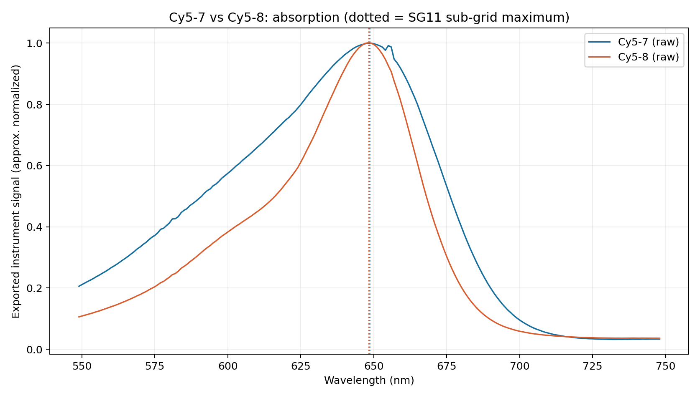

# XanPy — Beyond Absorption Maxima

**Reproducible reanalysis of substituent-associated spectral-shape changes in cyanine dyes** · Python · archived experimental absorption/emission data · 2026

[](./tests)
[](https://zenodo.org/records/20119205)
[](https://doi.org/10.1021/acs.joc.6c00573)

> **Scope:** This is an **independent computational reanalysis of publicly archived third-party spectra**, not an original synthesis, laboratory measurement, new TD-DFT calculation, or a statistically established validation of the Dunlop–Strada–Šebej 2026 substituent rule.

## Research question

Can two cyanine dyes show nearly identical absorption maxima but noticeably different **absorption band shapes** and **emission characteristics** after substitution at the polymethine chain C1′ position?

This repo analyzes **eight numeric absorption/emission traces** for four cyanines from Bedocchi, Okoročenkova and Klán (J. Org. Chem. 2026). Input archive fingerprints are verified against the Zenodo dataset before analysis.

## Key findings

| Pair (from → to) | Fitted Δabsorption λmax | Fitted Δemission λmax | Apparent absorption half-height width (from → to) |
|---|---:|---:|---:|
| **Cy5-7 → Cy5-8** (OMe → Cl) | **−0.38 nm** | **−12.19 nm** | **85.28 → 51.83 nm** |
| **Cy7-3 → Cy7-8** (OMe → NHAc) | **−4.61 nm** | **−17.11 nm** | **184.06 → 178.55 nm** |

Widths refer to **the exported, potentially overlapping spectral envelope** at half-height, *not* to a deconvolved electronic transition. A 39.2% reduction for the Cy5 *apparent envelope width* is descriptive and does **not** establish a physical linewidth mechanism. Shifts near 1 nm cannot be considered experimentally significant without replicates.



**See** [Results](docs/RESULTS.md) · [Methods](docs/METHODS.md) · [Limitations](docs/LIMITATIONS.md) · [Supervisor summary](docs/SUPERVISOR_SUMMARY.md) · [Prior stages](docs/PRIOR_WORK.md) · [How to cite](CITATION.md) · [فارسی: انتشار در GitHub](RUN_GITHUB_FA.md).

## Reproduce using original spectra (Linux Mint / macOS / Windows)

Python **3.10+**, an internet connection for the original downloads, ~50 MB free space for the four ZIP archives:

```bash
# From repository root:
python3 -m venv .venv
source .venv/bin/activate
python -m pip install -e '.[test]'

# Fetch original archives from the Zenodo authors and confirm MD5:
python scripts/download_zenodo.py

# Re-run analysis, JSON/CSV reports and PNG figures:
python -m xanpy_cyanine.analysis --zip-dir data/raw --out-dir results

# Deterministic unit tests and reference-data integration (when ZIPs exist):
python -m pytest -q
```

Already downloaded the four original ZIP archives? Instead of downloading again, use:

```bash
python -m xanpy_cyanine.analysis \
  --zip-dir ~/Downloads/XanPy-Stage19-Independent-Validation/raw_zips \
  --out-dir results
```

The original raw ZIPs are **not included in the repository** and are `.gitignore`d. Published figures and derived feature summaries are included so the repository is useful without a 50 MB download, but the code verifies input provenance before replacing them.

## Quick repository map

```text
src/xanpy_cyanine/analysis.py      # core numerical methods + verified archive reprocessing
data/source_manifest.json         # original DOI, archive checksums, comparison metadata
scripts/download_zenodo.py        # download and MD5-verify the four third-party archives
results/                          # reprocessed JSON + CSV metrics
figures/                          # six reprocessed plots
workflows/huckel/                 # optional idealized Hückel sign-rule model
workflows/fluodb/                 # optional historical FluoDB analysis scripts
workflows/cyanine_identity/       # strict structural screen; exploratory
.github/workflows/ci.yml         # numerical unit tests on GitHub Actions
```

## What this **doesn't** establish

- No uncertainty / p-value / experimental precision from single scans; Savitzky–Golay sensitivity is **not** an experimental confidence interval.
- No independent four-chain confirmation of the 2026 Hückel–Hammett `4n±1` rule: the original FluoDB screening found no validated qualifying substitution series for formal regression.
- No proof that C1′ electronic effects alone cause the different shape; aggregation, concentration, isomer state, pH and instrument processing are not independently controlled here.
- No raw spectral intensity → quantum yield or brightness claims.

## Original data & citation

This is a **reanalysis** of experimental spectra collected by **Ottavio Bedocchi, Jana Okoročenkova and Petr Klán**:

- [Bedocchi et al., *C1′-Substituted Penta- and Heptamethine Cyanines: Synthetic Scope and Properties*, J. Org. Chem. (2026)](https://doi.org/10.1021/acs.joc.6c00573)
- [Original archived numerical spectra, Zenodo DOI 10.5281/zenodo.20119205](https://doi.org/10.5281/zenodo.20119205)
- [Dunlop, Strada and Šebej, *Substituent Effects on Cyanine Dyes Vary with Position and Chain Length* (2026)](https://doi.org/10.1002/adom.202503219) — theoretical motivation, not a study experimentally reproduced in full here.

Code supplied under **MIT**; this license **does not relicense source data**. Please cite the original experimental authors and dataset when using plots or reanalyzed numbers. Author details for this GitHub repository may be added before publishing.
