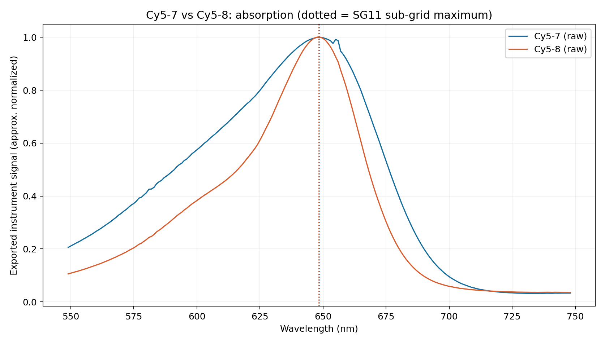
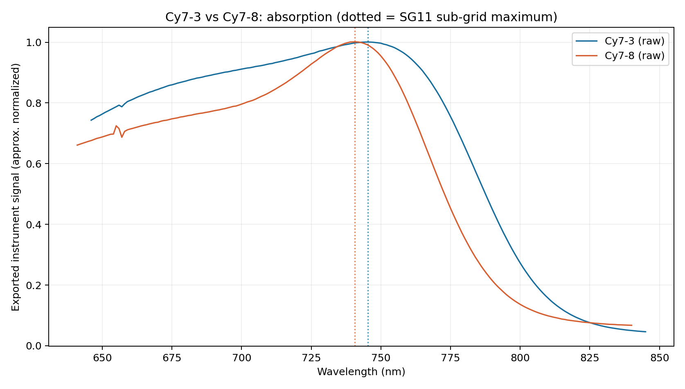

# Results: observed data vs scientific interpretation

These numbers are from direct reprocessing of the four **original, MD5-verified published ZIPs**, not newly acquired experimental measurements. Values use the 11-point Savitzky–Golay + quadratic estimator unless otherwise noted.

| Compound | Published absorb (nm) | Raw grid absorb (nm) | Fitted absorb (nm) | Fitted emission (nm) | Apparent absorb half-height width (nm) |
|---|---:|---:|---:|---:|---:|
| Cy5-7 | 649 | 649 | 648.600 | 693.545 | 85.279 |
| Cy5-8 | 649 | 648 | 648.217 | 681.352 | 51.831 |
| Cy7-3 | 745 | 745 | 745.276 | 805.938 | 184.057 |
| Cy7-8 | 741 | 741 | 740.669 | 788.824 | 178.549 |

## Pairwise descriptive results

- **Cy5-7 → Cy5-8:** fitted absorption change **−0.382 nm** (raw-grid −1 nm), fitted emission change **−12.192 nm**; apparent absorption half-height width **85.279 → 51.831 nm**, a difference **−33.448 nm** (39.2% relative decrease). This is a change in the **band envelope**, not a proved change in an isolated transition's intrinsic linewidth.
- **Cy7-3 → Cy7-8:** fitted absorption change **−4.607 nm** (raw-grid −4 nm), fitted emission change **−17.114 nm**; apparent absorption half-height width **184.057 → 178.549 nm**.

The spectral-shape observation is stronger than a claim about a one-nanometre displacement: the two Cy5 normalized absorption envelopes differ substantially even where the maxima largely coincide. This is an **observational** result from archived spectra, not a controlled mechanistic conclusion.

## Relation to the 2026 substituent rule

The direction of the Cy7 absorption change in this pair is consistent with a simple predicted blue shift for the chosen C1′ substitution under the previous ξ mapping. The small Cy5 difference is unresolved in practice without replicate scans. Neither case by itself proves or refutes the general chain-length/position-dependent rule.

**No new DFT, TD-DFT or laboratory measurements are claimed.** All original instrument measurements belong to the cited paper's authors.
